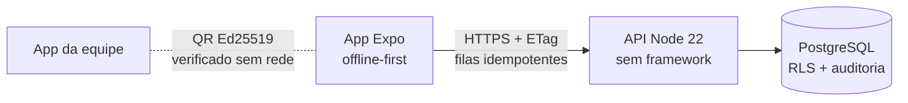

# Acessa Evento

**Um app de eventos em que acessibilidade é regra de engenharia, não etapa final.**
Inscrição, agenda, ingresso que funciona sem internet, check-in por QR e um assistente de dúvidas, pensados primeiro para quem usa leitor de tela, Libras, cadeira de rodas ou fonte grande.

[](https://github.com/ccpnexatech/acessa-evento/actions/workflows/verificar.yml)

<!-- capturas: as imagens abaixo vêm do emulador Android (docs/imagens) -->

## Por que existe

O Brasil tem **14,4 milhões de pessoas com deficiência** (IBGE, Censo 2022). Num evento, cada uma delas encontra uma sequência de pequenas barreiras: o formulário que o leitor de tela não lê, a programação em PDF, a fila que depende da internet do pavilhão, a palestra sem intérprete descoberta na hora.

Este projeto mostra, com código testado, como tirar essas barreiras do caminho. Comece pela [visão geral](docs/visao-geral.md).

## A jornada

| | Participante | Equipe do evento |
| --- | --- | --- |
| **Antes** | Encontra eventos "Com Libras", inscreve-se e diz, se quiser, que recurso precisa | Sabe quem pediu intérprete, legenda, audiodescrição ou acesso sem degraus |
| **No dia** | Vê na agenda só as sessões que consegue acompanhar; mostra o QR mesmo sem internet | Lê o QR sem internet e ouve "Pode entrar, precisa de intérprete de Libras" |
| **Dúvidas** | Assistente com respostas da organização, uma pergunta por tela, offline | Publica e corrige respostas; vê quais não ajudaram, sem saber quem perguntou |

## Como é feito



- **Nativo primeiro:** `node:http`, `node:test`, `node:crypto`. Terceiros só atrás de uma porta.
- **Offline onde importa:** agenda, ingresso, check-in e assistente.
- **Seguro no banco:** Row Level Security, dados sensíveis cifrados, auditoria encadeada.
- **Acessibilidade provada:** contraste testado nos tokens, lint próprio e auditor automático em 14 telas × 3 temas.
- **Decisões escritas:** [24 ADRs](docs/adr/README.md), cada uma com o que se ganha e o que se paga.

Detalhes em [arquitetura](docs/arquitetura.md) e [acessibilidade](docs/acessibilidade.md).

## Rodar

Requisitos: Node 22.18+ e Docker (ou PostgreSQL 14+).

```bash
npm install      # instala e liga os hooks do git
npm run dev      # banco, API, link público e app Expo, num comando
npm run verify   # lint, tipos, testes, segurança e integração
```

O `npm run dev` mostra um QR para abrir o app no celular, em qualquer rede. Roteiro completo em [teste manual](docs/teste-manual.md).

## Números

| | |
| --- | --- |
| Decisão do check-in sem internet | **2 ms** de mediana, lista de 3.000 pessoas |
| Auditoria de acessibilidade | **42 de 42** telas e temas sem violação |
| Recursos de acessibilidade | **8 de 8** implementados |
| Testes | **178** no app, **176** na API (45 contra PostgreSQL real) |

Como cada número foi medido, e o que ainda falta medir, em [impacto](docs/impacto.md).

## Documentação

| Para | Leia |
| --- | --- |
| Entender o problema e a proposta, sem código | [Visão geral](docs/visao-geral.md) |
| Ver como as peças se encaixam | [Arquitetura](docs/arquitetura.md) · [API](docs/api.md) · [ADRs](docs/adr/README.md) |
| Saber o que o app garante em acessibilidade | [Acessibilidade](docs/acessibilidade.md) · [Revisão manual](docs/acessibilidade-revisao-manual.md) |
| Estudar, ensinar ou fazer um TCC | [Guia de estudo](docs/estudo.md) · [Referências](docs/referencias.md) |
| Rodar e testar à mão | [Teste manual](docs/teste-manual.md) |
| Ver o comportamento esperado | [`features/`](features) (Gherkin, pt-BR) |

## Estado

As 8 fases do MVP estão no código. Faltam a revisão manual com leitores de tela, o primeiro build pelo EAS, a API publicada e, principalmente, **o teste com pessoas com deficiência** ([pendências](docs/impacto.md#pendências)).

## Como contribuir

Commits em [Conventional Commits](https://www.conventionalcommits.org/pt-br/v1.0.0/); o hook de push roda `npm run verify` e o CI repete. Decisão nova vira ADR. Tela nova entra na [auditoria de acessibilidade](apps/mobile/src/testes/acessibilidade.test.tsx).

Feito por [CCP NexaTech](https://github.com/ccpnexatech), em Fortaleza.
