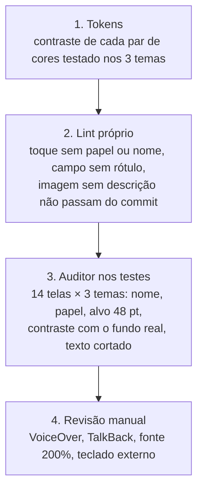

# Acessibilidade

Acessibilidade aqui é regra de engenharia, não etapa final. Este documento diz **o que** o app garante, **para quem** e **como** isso é provado.

## Referência

- **WCAG 2.2, nível AA** ([W3C, 2023](https://www.w3.org/TR/WCAG22/)), adaptada a app nativo. Onde as plataformas pedem mais, vale o mais exigente: alvo de toque de **48 pt** (o mínimo da WCAG 2.2 é 24 px, critério 2.5.8; o Android recomenda 48 dp ([Android Developers](https://developer.android.com/guide/topics/ui/accessibility/apps))).
- **Lei Brasileira de Inclusão** ([Lei 13.146/2015](https://planalto.gov.br/ccivil_03/_Ato2015-2018/2015/Lei/L13146.htm)): acessibilidade como direito, barreiras atitudinais e de comunicação, lugares reservados em auditórios (art. 44).
- **Manual de Acessibilidade em Eventos Presenciais** ([Ministério dos Direitos Humanos e da Cidadania, 2ª ed.](https://www.gov.br/mdh/pt-br/navegue-por-temas/pessoa-com-deficiencia/publicacoes/manual-de-acessibilidade-em-eventos-presenciais/1Manual_Acessibilidade_Eventos_defesoeleitoralv21.pdf)): perguntar na inscrição o recurso necessário, intérprete visível, lugares para quem usa Libras em frente ao intérprete, audiodescrição com receptor e fone. Várias telas do app nasceram dessas recomendações.

## Os 8 recursos cobertos

| Recurso | No app | Como é verificado |
| --- | --- | --- |
| Libras | Selo e filtro na agenda; filtro "Com Libras" nos eventos; pedido na inscrição; a equipe vê "Precisa de intérprete de Libras" e onde indicar o lugar | Testes das telas de agenda, eventos e credenciamento |
| Legenda | Selo, filtro e pedido na inscrição | Idem |
| Audiodescrição | Selo, filtro, pedido e orientação à equipe (fone no balcão) | Idem |
| Rota sem degraus | Acessibilidade de cada sala no detalhe da palestra; pedido "acesso sem degraus" | Teste do detalhe da palestra |
| Alto contraste | Tema próprio; segue "Aumentar contraste" (iOS) e "Texto em alto contraste" (Android) ou a escolha em Ajuda | Testes do tema; auditoria nos 3 temas |
| Fonte em 200% | Nenhum texto com limite de linhas ou de escala; componentes com altura mínima, não fixa | Teste estático + revisão manual |
| Reduzir movimento | O app não tem animações | Teste estático que impede `Animated` e `LayoutAnimation` |
| Leitor de tela | Papel, nome e estado em todo controle; anúncios de mudança (sem internet, passo da inscrição, resultado do check-in) | Auditoria automática + revisão manual |

## Como é provado: quatro camadas

1. **Tokens** ([`packages/tokens`](../packages/tokens)). O contratante escolhe só 5 chaves de marca; cores de texto, superfície e estado são fixas e cada par é testado contra 4,5:1 ([ADR 0011](adr/0011-design-system-com-tema-de-5-chaves-e-3-temas-fixos-de-a.md)).
2. **Lint** ([`tools/eslint/acessibilidade.mjs`](../tools/eslint/acessibilidade.mjs)). Quatro regras próprias, com teste. Um botão sem nome não chega à `master` ([ADR 0020](adr/0020-acessibilidade-verificada-na-escrita-e-nos-testes.md)).
3. **Auditor** ([`apps/mobile/src/testes/auditoria.ts`](../apps/mobile/src/testes/auditoria.ts)). Percorre a árvore renderizada e acha o fundo real de cada texto subindo pelos pais. Na primeira execução encontrou dois problemas que os testes de componente não pegavam: a estrela de favorito com 1,5:1 e cartões sem alvo mínimo ([ADR 0024](adr/0024-qualidade-verificavel-auditor-sentry-e-eas.md)).
4. **Revisão manual** ([roteiro](acessibilidade-revisao-manual.md)). O que só uma pessoa com o aparelho confirma: ordem de leitura, o que se ouve, layout com fonte enorme.

E, acima das quatro, o que nenhuma delas substitui: **teste com pessoas com deficiência** ([como fazer](estudo.md#pesquisa-com-pessoas)).

## Padrões que valem copiar

- **Um cartão, uma frase.** O cartão da sessão é um botão só, lido como "Abertura. 09:00 às 10:00, Auditório. Acontecendo agora". A estrela de favorito é um botão à parte, "Favoritar Abertura", com estado "marcado".
- **Cor nunca sozinha.** Filtro ligado ganha "✓"; ingresso esgotado aparece riscado **e** com a palavra "Esgotado"; "Agora" é um selo com texto.
- **Anunciar o que muda sem mudar de tela.** Perda de internet, passo da inscrição e resultado do check-in são falados (`announceForAccessibility`; região viva no Android).
- **Anel de foco de 3 pt** em todo controle, para teclado externo e switch, sem deslocar o layout (`outline`). O componente [`Tocavel`](../apps/mobile/src/shared/ui/Tocavel.tsx) é o único `Pressable` do app.
- **Login sem senha.** Código de 6 números por e-mail: nada para memorizar (WCAG 2.2, critério 3.3.8, autenticação acessível).
- **Dado de acessibilidade é sensível.** Opcional, só a organização vê, apagado 30 dias depois do evento.

## Limites conhecidos

- O auditor cobre as regras mais comuns da WCAG AA, não todas (ordem de foco, leitura de tabelas e gestos complexos ficam com a revisão manual).
- Tradução para Libras no app e audiodescrição ao vivo pelo celular não existem ainda; estão entre as [propostas de extensão](estudo.md#propostas-de-extensão).
