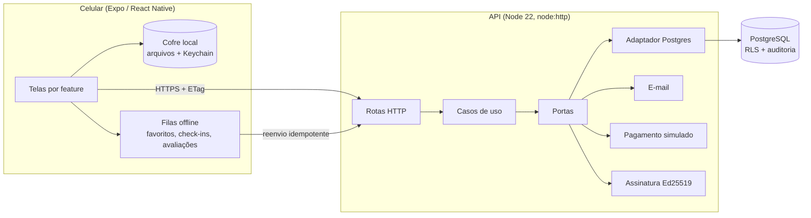
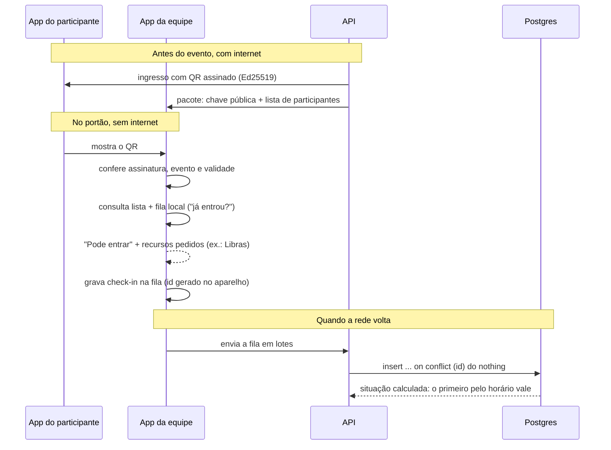
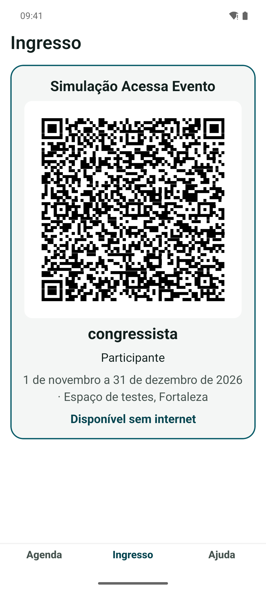
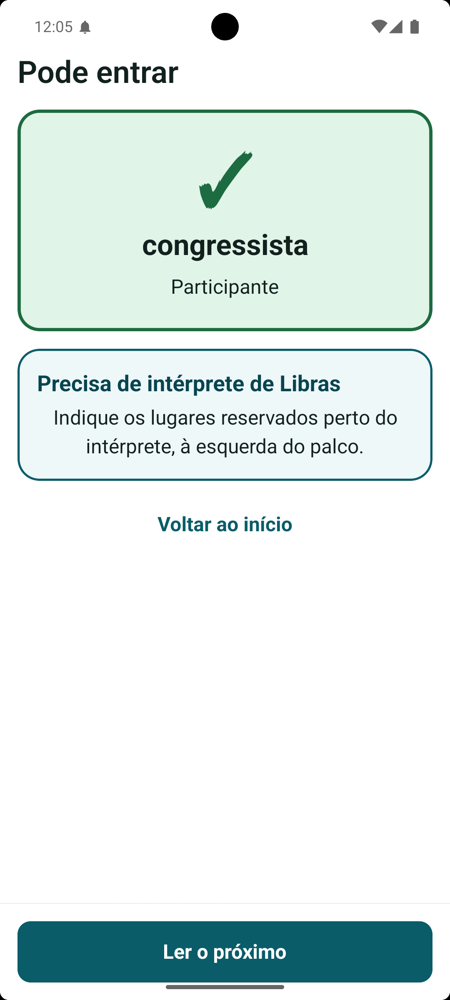
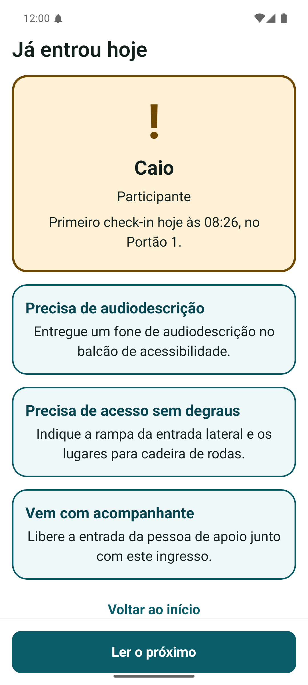
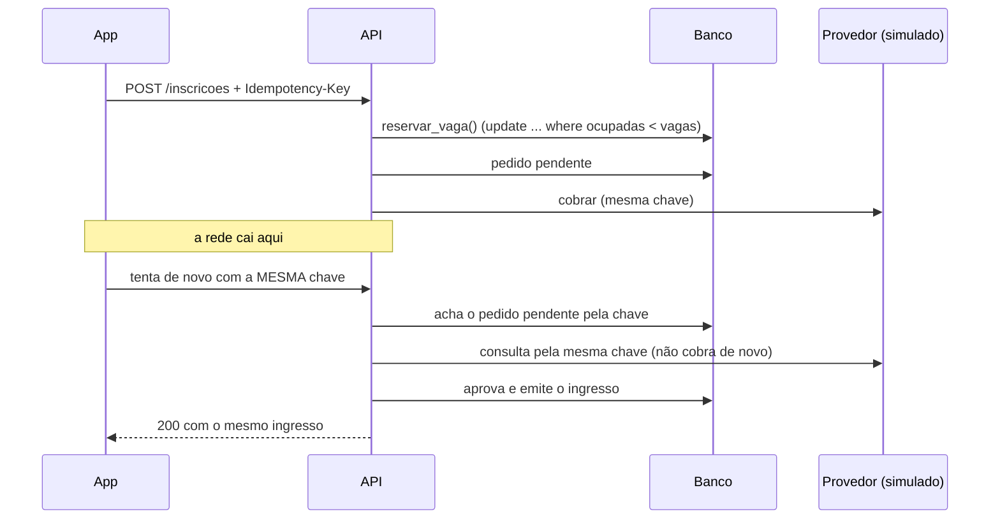
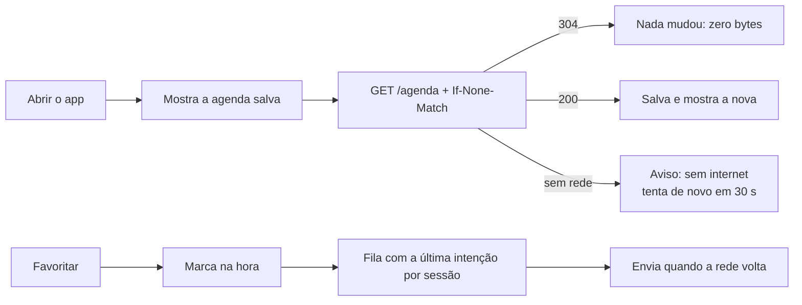
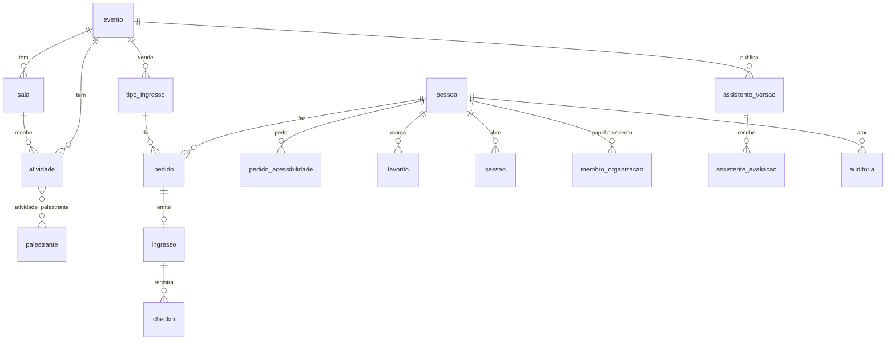

# Arquitetura

Como as peças se encaixam e por quê. Cada escolha aponta para o ADR que a justifica.

## Visão de cima



Três ideias guiam tudo:

1. **Nativo primeiro.** Servidor em `node:http`, testes em `node:test`, criptografia em `node:crypto`. Biblioteca de terceiros só onde a plataforma não resolve, e sempre atrás de uma porta ([ADR 0013](adr/0013-sql-puro-com-pg-e-repositorios.md), [ADR 0014](adr/0014-api-em-node-nativo.md)).
2. **O aparelho é a fonte de verdade enquanto não há rede.** Agenda, ingresso, check-in e assistente funcionam offline; o servidor reconcilia depois ([ADR 0018](adr/0018-cache-offline-e-fila-de-favoritos-proprios.md), [ADR 0022](adr/0022-qr-assinado-e-credenciamento-offline.md)).
3. **O banco protege os dados mesmo se a API errar.** Row Level Security, colunas cifradas e auditoria encadeada ([ADR 0002](adr/0002-postgresql-com-isolamento-por-evento-via-rls.md), [ADR 0005](adr/0005-auditoria-so-de-insercao-com-cadeia-de-hash.md), [ADR 0016](adr/0016-banco-real-nos-testes-e-rls-sem-force.md)).

## Pastas

```
apps/
  api/            Node 22 com type stripping, sem framework
    src/modules/  conta · programacao · inscricao · credenciamento · assistente · saude
      <módulo>/domain        regras puras, sem I/O
      <módulo>/application   casos de uso e portas (interfaces)
      <módulo>/adapters      HTTP e Postgres
    src/main/     composição: liga portas a adaptadores
    db/           migrações SQL numeradas e sementes
  mobile/         Expo Router, organizado por feature
    src/app/          rotas finas (só navegação)
    src/features/     telas, regras e sincronização de cada fluxo
    src/shared/       tema, componentes, cliente HTTP, cofre
packages/tokens/  design system: 3 temas, contraste testado
features/         comportamento esperado em Gherkin (pt-BR)
docs/adr/         decisões
tools/eslint/     regras próprias de acessibilidade
scripts/          portão de qualidade, dev, segurança
```

O lint impede que `domain` e `application` importem banco, rede ou adaptadores ([ADR 0014](adr/0014-api-em-node-nativo.md)). No app, as telas recebem navegação, câmera e vibração por props; por isso são testadas sem simulador ([ADR 0019](adr/0019-expo-router.md)).

## Três fluxos que valem o estudo

### 1. Check-in sem internet

A pergunta difícil: como decidir "pode entrar" em menos de um segundo, num pavilhão sem rede, sem aceitar QR falso nem contar a mesma pessoa duas vezes?



<p align="center">
  
  &nbsp;
  
  &nbsp;
  
</p>

- O QR tem só ids e validade. Nome e acessibilidade ficam na lista da equipe, não num código que qualquer câmera lê.
- A API assina com o crypto nativo do Node; o app confere com `@noble/curves`. Um **vetor de teste idêntico** nos dois lados impede que os formatos se desencontrem.
- O banco não guarda "válido" ou "repetido": calcula pela ordem de horário. Dois portões offline chegam ao mesmo relatório em qualquer ordem de envio.

Código: [`apps/api/src/shared/qr/token.ts`](../apps/api/src/shared/qr/token.ts), [`apps/mobile/src/features/credenciamento/modelo.ts`](../apps/mobile/src/features/credenciamento/modelo.ts), [`apps/api/db/migracoes/0008_credenciamento.sql`](../apps/api/db/migracoes/0008_credenciamento.sql).

### 2. Pagar sem cobrar duas vezes



O número do cartão só passa pela memória; o pedido guarda os 4 últimos dígitos. A disputa pela última vaga é resolvida numa única instrução SQL e testada com três pedidos simultâneos ([ADR 0021](adr/0021-inscricao-idempotente-e-vagas-no-banco.md)).

### 3. Agenda que abre sem rede



## Dados



- **Dado sensível cifrado.** E-mail em AES-256-GCM com id de chave; busca por HMAC ([ADR 0002](adr/0002-postgresql-com-isolamento-por-evento-via-rls.md)).
- **Pedido de acessibilidade com prazo.** Apagado 30 dias depois do evento ([ADR 0012](adr/0012-retencao-de-dados-5-anos-para-fiscais-30-dias-para-aces.md)). Tratamos a informação sobre deficiência como dado de saúde, que a LGPD classifica como sensível ([Lei 13.709/2018, art. 5º, II](https://planalto.gov.br/ccivil_03/_ato2015-2018/2018/lei/l13709.htm)).
- **Pedido fiscal sobrevive à exclusão da conta**, sem ligação com a pessoa.
- **Avaliação do assistente sem pessoa, sem hora**, só o dia ([ADR 0023](adr/0023-assistente-versionado-e-avaliacao-anonima.md)).

## Segurança em camadas

| Camada | O que garante | Onde está testado |
| --- | --- | --- |
| Banco (RLS) | Ninguém lê dado de outra pessoa nem de outro evento, mesmo com bug na API | `apps/api/test/integracao/*.int.ts`, contra Postgres real |
| Funções `security definer` | Operações sensíveis (vaga, lista da equipe) conferem papel antes | `credenciamento.int.ts`, `inscricao.int.ts` |
| Auditoria encadeada | Alteração ou remoção de registro é detectável | `seguranca-banco.int.ts` |
| Sessão opaca | Token de 256 bits; o banco guarda só o HMAC | `acesso.test.ts`, `conta.int.ts` |
| Portão de qualidade | Lint, tipos, testes, `npm audit` e varredura de segredos em todo push | `scripts/verify.ts`, CI |

## Qualidade

Todo push passa pelo mesmo portão na máquina e no CI: lint (com regras próprias de acessibilidade), typecheck, testes, segurança e integração contra PostgreSQL ([ADR 0015](adr/0015-fluxo-git-e-portao-de-qualidade.md)). Erros inesperados vão ao Sentry por um relator próprio, sem SDK e sem dados pessoais ([ADR 0024](adr/0024-qualidade-verificavel-auditor-sentry-e-eas.md)).

## Mapa das decisões

Os [24 ADRs](adr/README.md) seguem o formato MADR simplificado: contexto, decisão, consequências (o que se ganha e o que se paga). ADR aceito não se edita; uma mudança gera outro que o substitui, como o 0013 substituiu o 0004 (Prisma → SQL puro) e o 0017 substituiu o 0003 (Supabase Auth → autenticação própria).
