# Telas e fluxos

Capturas do app real, num emulador Android, com os dados do evento de simulação. Geradas por [`scripts/capturas.sh`](../scripts/capturas.sh); para atualizar, rode o script de novo.

## Fluxos

| Inscrição | Agenda | Assistente |
| :---: | :---: | :---: |
| 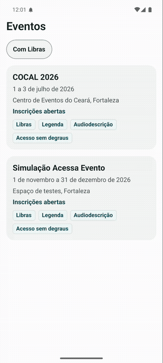 | 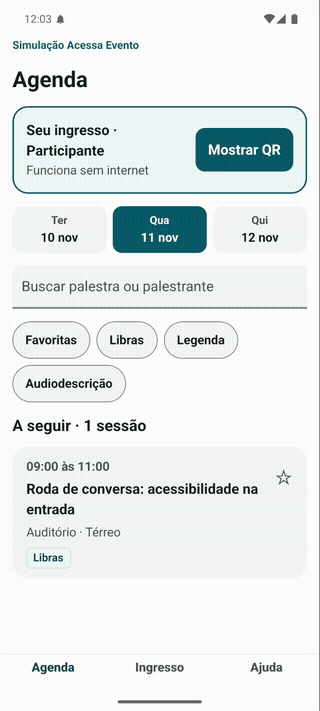 | 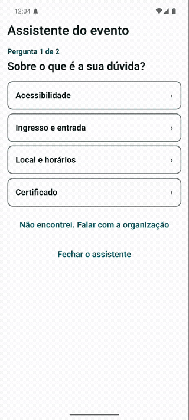 |

## Participante

| | | |
| :---: | :---: | :---: |
| 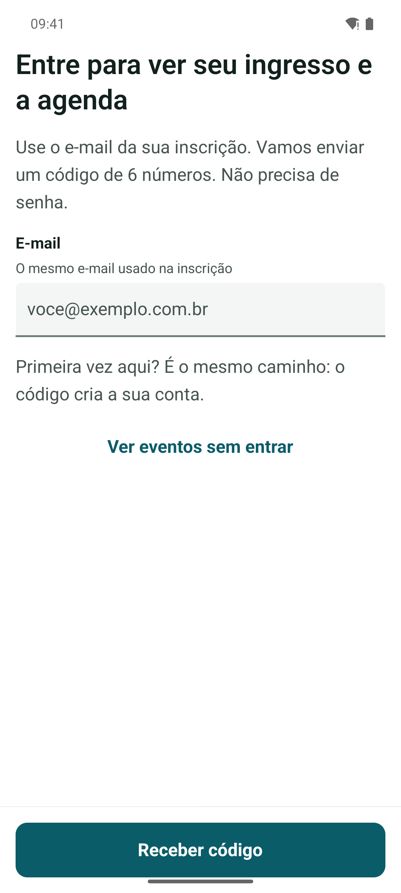 | 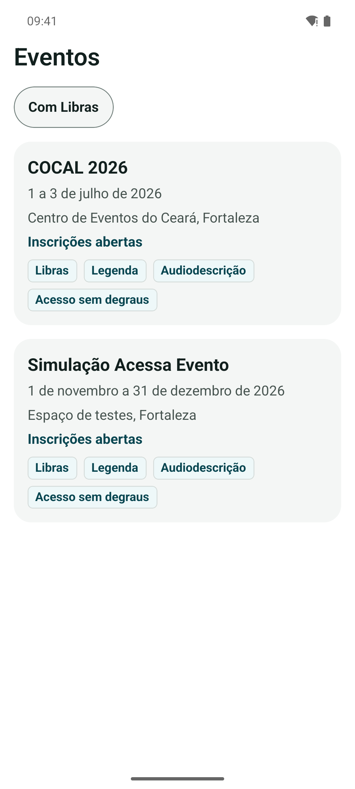 | 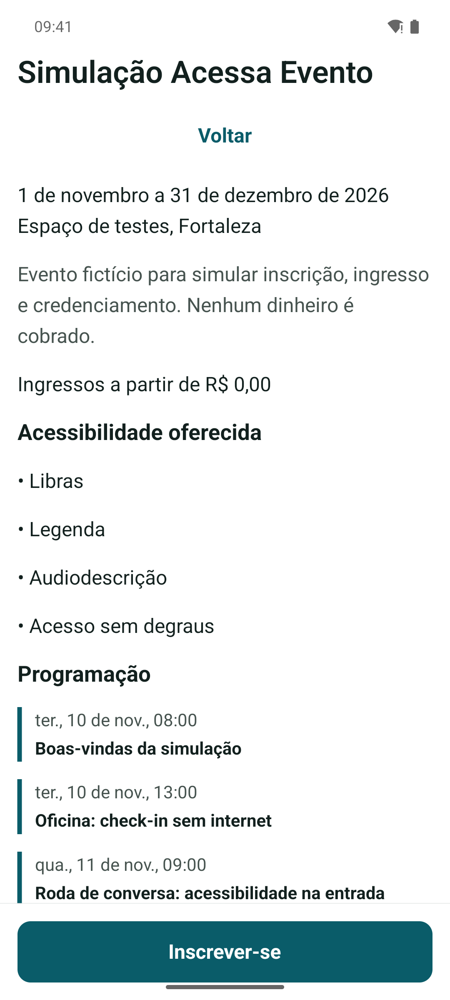 |
| **Entrar** sem senha: código de 6 números por e-mail. Dá para ver os eventos antes de entrar. | **Eventos** com o filtro "Com Libras" e o que cada um oferece. | **Página do evento**: acessibilidade oferecida antes de comprar. |
| 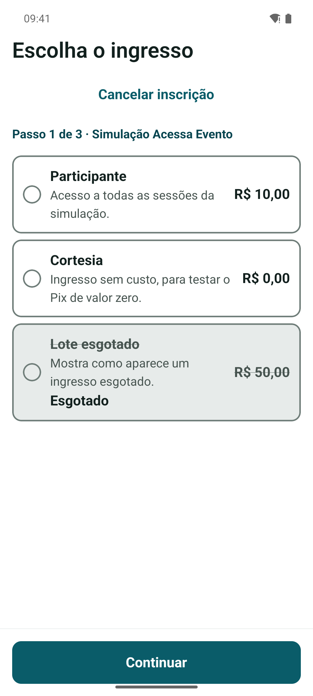 | 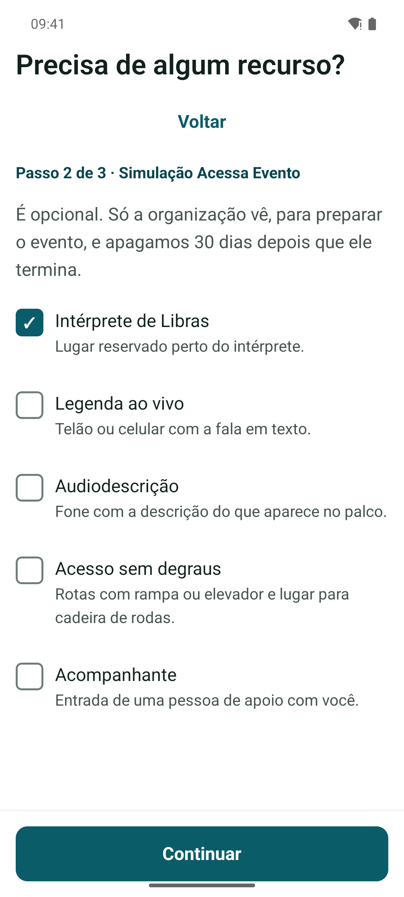 | 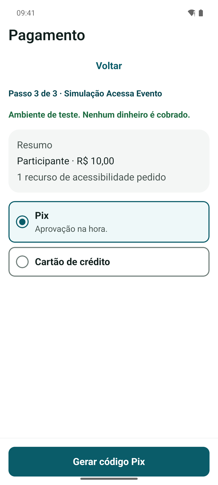 |
| **Ingresso**: o esgotado é riscado **e** escrito; cor nunca sozinha. | **Recurso de acessibilidade**: opcional, explicado, apagado 30 dias após o evento. | **Pagamento** simulado, sem cobrar duas vezes. |
| 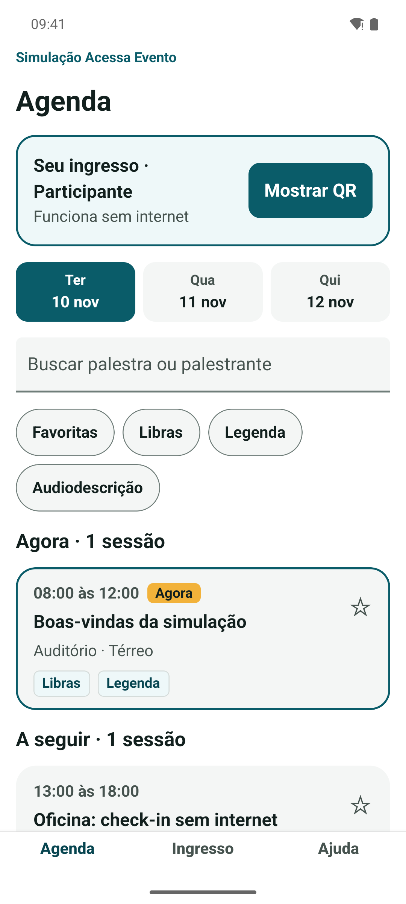 | 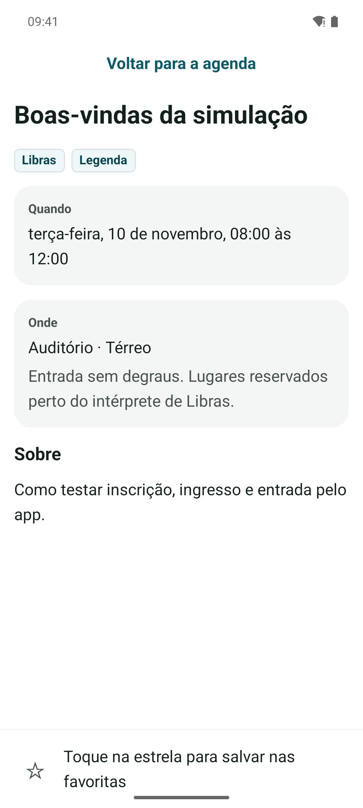 | 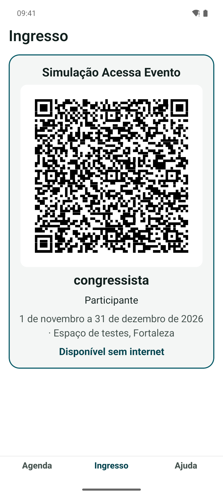 |
| **Agenda** com "Agora" e "A seguir"; abre sem internet. | **Detalhe**: como chegar à sala sem degraus. | **Ingresso**: QR assinado que vale sem internet; brilho no máximo. |
| 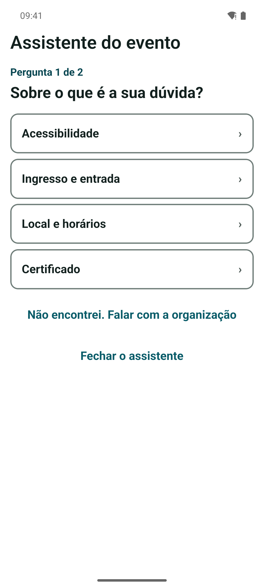 | 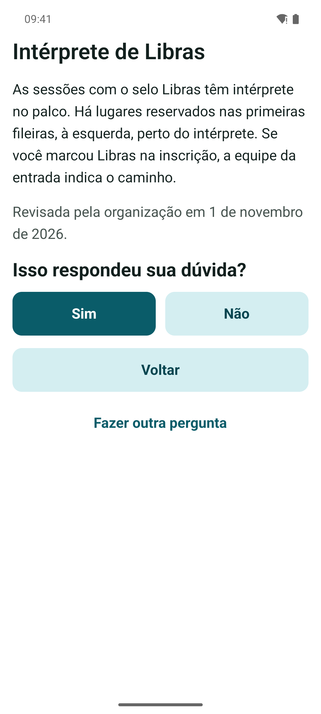 | 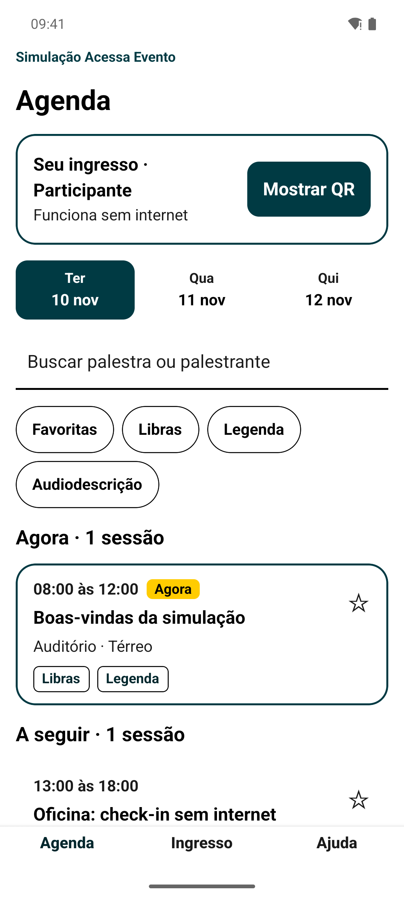 |
| **Assistente**: uma pergunta por tela. | **Resposta** revisada pela organização, com data. | **Alto contraste**, do sistema ou escolhido em Ajuda. |

## Equipe do credenciamento

| | | |
| :---: | :---: | :---: |
| 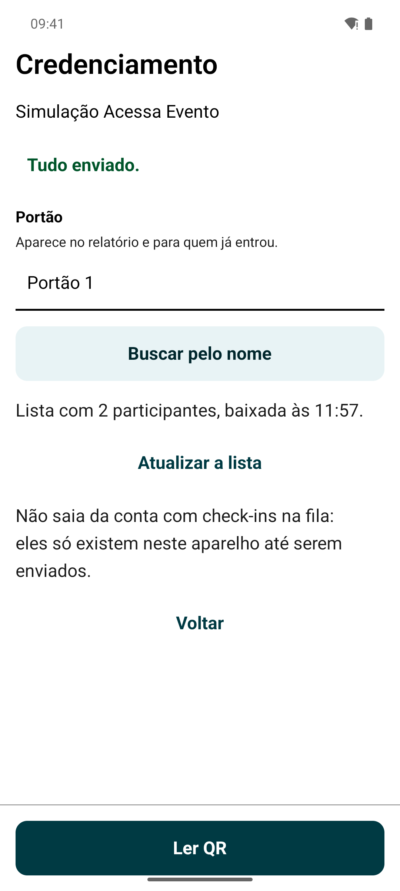 | 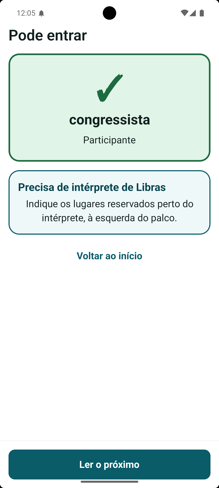 | 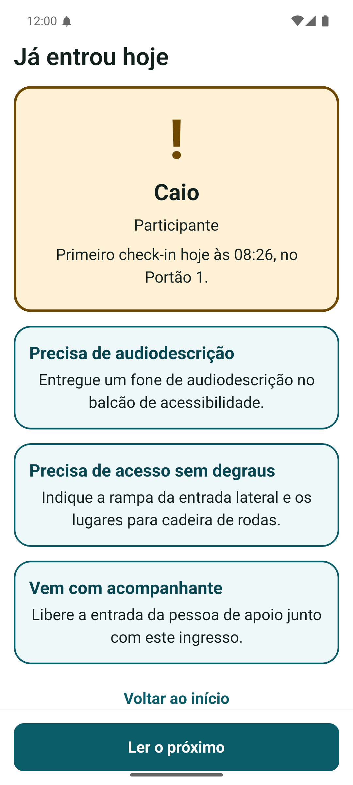 |
| **Início**: portão, fila e lista baixada. | **Pode entrar**, sem internet, já dizendo o recurso pedido. | **Já entrou hoje**, com hora e portão do primeiro check-in. |

## Tema padrão e alto contraste

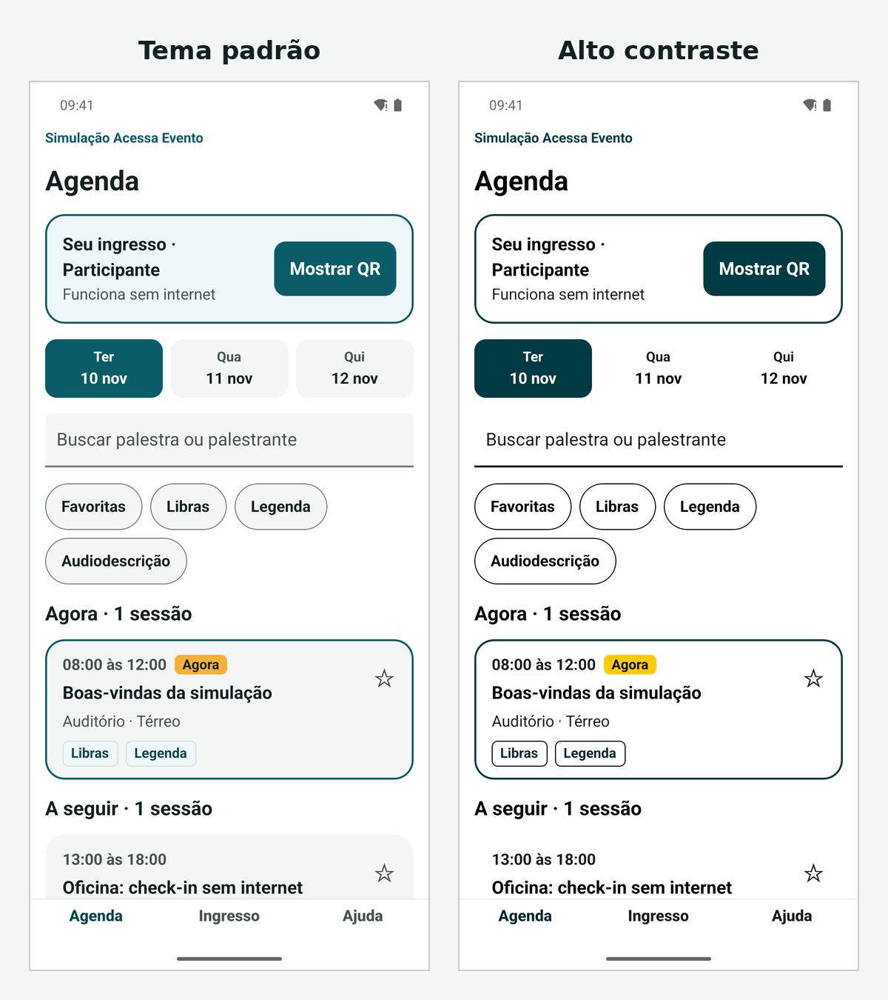
